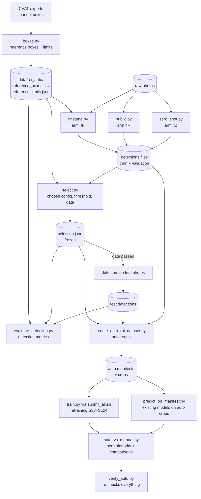

# T19 code guide: every function and how they fit together

Experiment 4 (auto-box ROI) replaces the manual CVAT boxes with boxes from wound detectors, then asks whether the classifiers still work as well. This guide covers:

1. **The pipeline**: which script runs at each runbook step, what it reads and what it writes.
2. **How the functions combine** inside each script, step by step.
3. **Every function**, file by file, with one line on what it does and who calls it.

The plan and its reasons are in `tickets/T19_auto_box_roi.md`; the commands are in `runbook.md` ("Auto-box ROI experiment (T19)").

---

## 1. The pipeline



**Runbook step → script → output**

| Step | Script | Reads | Writes |
|---|---|---|---|
| 0 (laptop) | `src/detection/boxes.py` | CVAT exports, `data/roi_box/roi_manifest.csv` | `data/roi_auto/reference_boxes.csv`, `reference_limits.json` |
| 2 | `src/detection/finetune.py train` (×3 learning rates, then ×5 cross-fit folds) | raw photos, reference boxes | `detector/lr*/` (`best.pt`, `validation.csv`), `crossfit/fold*/train_fold*.csv` |
| 3 | `src/detection/zero_shot.py` (gdino, owlv2) | raw photos | `detection/dev/<model>_<prompt>[_tiled].csv` (8 per model) |
| 4 | `src/detection/public.py prepare` → `detect` | Hanterdsith checkpoints, raw photos | `weights/` (safetensors), `detection/dev/<size>_<colour>.csv` |
| 2–4 | `src/detection/select.py` | one arm's dev detections | `detection/selection.json` |
| 2–4 | the arm's script again, `--splits test` | `selection.json` (must pass the gate) | `detection/test/<chosen>.csv` |
| 5 | `src/detection/evaluate_detection.py` | test detections, `selection.json` | `detection/test_metrics/` |
| 5 | `src/data/create_auto_roi_dataset.py` | all detections of the chosen config, `selection.json` | `data/roi_auto/<arm>/{union,box}/roi_manifest.csv`, crops |
| 6 | `src/evaluation/predict_on_manifest.py` | existing models (main, roi_box), auto manifests | `auto_<arm>/primary/{roi,box}/<family>/test_predictions.csv` |
| 7 | `scripts/hpc/submit_all.sh` with `AUTO_ARM` → `train.py`, `cnn_svm.py` | auto manifests and crops | `auto_<arm>_{union,box,crop}/` |
| 8 | `src/evaluation/auto_vs_manual.py` | manual and auto predictions, selections | `auto_summary/*.csv`, `arms.json` |
| 8 | `src/evaluation/gradcam.py --auto-arm` | existing models, auto crops | `gradcam_auto_<arm>/` |
| 8 | `src/evaluation/verify_auto.py` | everything above | `auto_summary/verification/verification_report.csv` |

Every Raptor step runs as one job of `scripts/slurm/exp4.sbatch`.

---

## 2. How the functions combine, script by script

### `boxes.py` (step 0)

`main` → `read_manual_boxes` → for each photo `_check_photo` (pad each CVAT box, compare it with the manifest crop) → `training_limits` → write the CSV and JSON.

### The shared rules for one photo (used by everything that touches detections)

```
raw boxes from a detector
  └─ candidate_boxes   (boxes.py)  drop oversize → nms → top 100        ← mAP is computed here
       └─ final_boxes  (boxes.py)  score ≥ threshold → cap 35 → fallback (top box, else full image)
            └─ padded_crop_box (boxes.py)  8% padding, T03 rounding     ← the crop
```

`greedy_match` (boxes.py) pairs auto boxes with manual boxes at IoU ≥ 0.5. It is used for the threshold choice and for precision and recall.

### `zero_shot.py` (arm 4Z)

`main` → `photo_table` (photos of the requested splits) → `load_detector` (Grounding DINO or OWLv2, returns a `detect(image, phrases)` function) → `run`:
- for every photo: `load_photo`;
- for every configuration: `detect_photo`, which runs `detect` on the full photo and, if tiled, on each of the 4 `tiles`, keeping the `top` boxes of each pass;
- then `detection_rows`;
- at the end: `write_detections`, one file per configuration.

`config_order` lists the 16 configurations in tie order. `test_allowed` (in `parse_args`) refuses test without a passing `selection.json`.

### `public.py` (arm 4P)

- `prepare`, once: for each checkpoint, picklescan → one load with ultralytics → save as safetensors with `sha256` → `weights.json`.
- `main detect`: `load_detector` rebuilds YOLO from the saved architecture and safetensors, returning `detect(image)` → `run` → `load_photo` → `detect` (on colour or `as_input` grey) → `detection_rows` → `write_detections`, keeping `source_class`.
- `willie_smoke`: the single WILLIE load test, writing `willie_smoke.json`.

### `finetune.py` (arm 4F)

`main train` → `train`:
1. `seed_all` → `photo_table` and `reference_photos` (manual boxes) → `PhotoCache` (photos shrunk to 1365 px).
2. `build_model` (Faster R-CNN, 2 classes).
3. **Each epoch:** for each batch, `augment` → `to_tensor` → model loss → SGD step. Then `detect_photos` on validation → `validation_ap50` (`candidates` + `coco_ap`) → keep `best.pt` → early stopping.
4. **Main run:** reload `best.pt` → `detect_photos` → `write_detections` to `validation.csv`.
5. **Cross-fit run** (`--holdout-fold`): fixed epochs, then `detect_photos` on the held-out fold only → `train_fold<k>.csv`.

`main detect` → `detect`: `test_allowed` → `build_model` + `best.pt` → `detect_photos` → `write_detections`.

### `select.py` (choose one arm's configuration)

`main` → `select`:
- for each configuration: `load_detections` → drop test rows (counted) → `candidates` → `coco_ap(coco_images(...))`.
- Pick the highest AP@0.5 (ties: earlier in `--configs`).
- `choose_threshold` (F1-maximising threshold, its recall) → `gate_passed` (recall ≥ 0.50).

`main` then adds `file_sha256` of every file and writes `selection.json`. It refuses to overwrite an existing one.

### `evaluate_detection.py` (detection metrics)

`main` → `reference_photos` → `candidates(load_detections(...))` → `evaluate`:
- `coco_ap` (with `_area` size bins);
- `finalize` (`final_boxes` per photo) → `photo_results` (`greedy_match` per photo) → `operating_metrics`;
- `bootstrap` (case resamples of `coco_ap` and the counts).

This runs once overall and once per wound type. `choose_threshold` uses `ranked_hits`: one greedy pass, after which every threshold is a prefix of the score order.

### `create_auto_roi_dataset.py` (auto crops)

`main` → check `selection.json` (gate, limits) → `load_detections` for every file (a photo in two files is an error) → `photo_table` → `final_boxes_by_photo` (`candidate_boxes` + `final_boxes` per photo) → `build_rows` (`padded_crop_box`: one union crop and one crop per box) → write both manifests → with `--image-root`, `load_photo` and save each crop.

### `predict_on_manifest.py` (primary analysis: existing models on auto crops)

`main` → for each family, `run_config` (via `config_folder`) gives its classes → `test_rows` → `family_predictions`:
- **single network:** `network_probs` (`checkpoint_folder` → `best.pt` → `loader_for` → `predict`).
- **AlexNet ensemble:** `network_probs` for each of the 3 members, averaged.
- **CNN-SVM:** `svm_model` (refit from cached features with `manifest_rows`) → `svm_probs` (`extract` features → `predict_proba`).

The result goes to `prediction_frame` → `test_predictions.csv`. With `--check-manual`, `check_manual` re-predicts the manual crops and compares them with the reported file.

### `auto_vs_manual.py` (the comparisons)

`main`:
1. `family_set` (via `predictions`, `photo_level`) for full, manual union and manual box.
2. For each arm: read `selection.json`. If the gate failed, skip the arm. Otherwise `no_overlap_share`.
3. For each design (union, box):
   - `family_set` for the auto predictions;
   - `paired_draws` (summarize.py, shared resamples) → `paired_comparison` (per family, Holm over 8);
   - `pooled` → `verdict` (non-inferiority at margin 0.03);
   - `subset_difference` (with `photo_keys`) for the fallback sensitivity;
   - retrained and versus-full comparisons with `paired_comparison`.
4. `holm` over the primary tests → write the tables (`tag` labels each one).

### `verify_auto.py` (re-checks)

`main` → `check_reference` → for each arm:
- `check_selection` (reruns `select`, compares hashes);
- `check_order`;
- `check_weights` (4P);
- if passed: `check_crossfit` (4F) → `check_crops` (rebuilds the crops with `final_boxes_by_photo` + `build_rows`) → `check_primary` → `check_budget`.

Then `check_numbers` (recomputes the primary differences). Each check runs inside `Report.guard`, so a missing file is a FAIL, not a crash.

---

## 3. Every function

### `src/detection/boxes.py`: reference boxes and the shared box rules

| Function | What it does | Used by |
|---|---|---|
| `read_manual_boxes` | Reads the unpadded CVAT boxes; refuses unless each, padded, equals its per-box manifest crop | `main`, tests |
| `_check_photo` | One photo: same number of boxes as crops; every padded box equals its crop | `read_manual_boxes` |
| `training_limits` | From the training split: largest box share (oversize rule), most boxes per photo (cap), size-bin tertiles | `main` |
| `as_boxes` | Turns input into an `(N, 4)` array and checks x2 ≥ x1, y2 ≥ y1 | almost every box function |
| `box_area` | Area of each box | `area_share`, `iou_matrix` |
| `area_share` | Each box's area as a share of its image | `candidate_boxes`, `training_limits`, `_area` |
| `iou_matrix` | Intersection over union of every pair of boxes | `nms`, `greedy_match`, `no_overlap_share` |
| `score_order` | Indices by descending score, ties kept in input order | `nms`, `final_boxes`, `greedy_match` |
| `nms` | Non-maximum suppression: drops boxes overlapping a higher-scoring kept box (IoU > 0.5) | `candidate_boxes` |
| `candidate_boxes` | Step 1: oversize rule → NMS → top 100 | `candidates`, `final_boxes_by_photo` |
| `final_boxes` | Step 3: threshold → cap → fallback (top box, else full image) | `finalize`, `final_boxes_by_photo` |
| `padded_crop_box` | The 8%-padded crop around boxes, rounded exactly as T03 does | `build_rows`, `check_reference`, tests |
| `greedy_match` | One-to-one matching of auto to manual boxes by score at IoU ≥ 0.5 (COCO's rule) | `ranked_hits`, `photo_results` |
| `parse_args`, `main` | Script: write `reference_boxes.csv` and `reference_limits.json` | runbook step 0 |

### `src/detection/evaluate_detection.py`: detection metrics, threshold and gate

| Function | What it does | Used by |
|---|---|---|
| `reference_photos` | One row per photo of given splits, with its manual boxes as an array | `main`, `select`, `finetune.train` |
| `load_detections` | Reads a detections file and checks columns, numbers and box order | `main`, `select`, `create_auto_roi_dataset` |
| `candidates` | `candidate_boxes` for every photo of a set (photos without detections get none) | `main`, `select`, `validation_ap50` |
| `coco_ap` | COCO average precision with pycocotools: AP, AP@0.5, AP@0.75, AP by size | `evaluate`, `select`, `validation_ap50`, `bootstrap` |
| `_area` | The area COCO uses: image share (with size bins) or pixels | `coco_ap` |
| `coco_images` | Packs photos and their candidates into `coco_ap`'s input | `evaluate`, `select`, `bootstrap` |
| `ranked_hits` | Every capped candidate with its score and whether it matches a manual box | `choose_threshold` |
| `choose_threshold` | The score threshold with the best F1 (ties → higher), with its precision and recall | `select` |
| `gate_passed` | Recall ≥ 0.50? | `select` |
| `finalize` | `final_boxes` for every photo at the operating threshold | `evaluate`, `main` |
| `photo_results` | Per photo: manual boxes, final boxes, matches, IoU sum, fallback | `evaluate` |
| `operating_metrics` | Precision, recall, F1, mean IoU, fallback shares, photo-level rates | `evaluate` |
| `bootstrap` | 95% case-bootstrap intervals for AP@0.5, precision, recall and photo rates | `evaluate` |
| `evaluate` | All of the above for one set of photos | `main` (overall and per wound type) |
| `parse_args`, `main` | Script: metrics on a split; refuses test for an arm that failed its gate | runbook step 5 |

### `src/detection/select.py`: choosing an arm's configuration

| Function | What it does | Used by |
|---|---|---|
| `file_sha256` | SHA-256 of a file (detections files are recorded by hash) | `main`, `check_selection` |
| `select` | Scores every configuration on the arm's selection photos (no test), picks the best, sets the threshold, judges the gate | `main`, `check_selection` |
| `parse_args`, `main` | Script: write `selection.json` once | runbook steps 2–4 |

### `src/detection/common.py`: what all three detector arms share

| Function | What it does | Used by |
|---|---|---|
| `photo_table` | One row per photo (case, label, split, size) from the per-box manifest | all three arms, `create_auto_roi_dataset`, `verify_auto` |
| `load_photo` | Opens a raw photo upright (EXIF), checks its size against the manifest | all three arms, `create_auto_roi_dataset` |
| `detection_rows` | Turns boxes and scores into detections-file rows, clipped to the image | all three arms |
| `write_detections` | Writes a detections file, never over an existing one | all three arms |
| `test_allowed` | Refuses test photos unless `selection.json` exists, passed its gate and chose this config | all three arms' `parse_args` / `detect` |

### `src/detection/zero_shot.py`: arm 4Z

| Function | What it does | Used by |
|---|---|---|
| `grounding_text` | Joins phrases into Grounding DINO's prompt format (`a . b .`) | `load_detector` |
| `config_name` | Builds a configuration name, e.g. `gdino_P2_tiled` | `config_order` |
| `config_order` | The 16 configurations, simplest first (the tie order) | `main`, runbook |
| `tiles` | The four 60% corner tiles of a photo | `detect_photo` |
| `top` | Keeps the 300 highest-scoring boxes of one pass | `detect_photo` |
| `detect_photo` | Full-photo pass plus, if tiled, four tile passes mapped back to photo pixels | `run` |
| `load_detector` | Loads Grounding DINO or OWLv2 offline; returns `detect(image, phrases)` → boxes, scores | `main` |
| `run` | Every photo × every configuration → detections files | `main`, tests |
| `parse_args`, `main` | Script; test only with `--config` and a passing `--selection` | runbook step 3 |

### `src/detection/public.py`: arm 4P

| Function | What it does | Used by |
|---|---|---|
| `config_order` | The 6 configurations (3 sizes × colour/grey), smallest first | `main`, runbook |
| `as_input` | Grey input: the photo's luminance in three channels | `load_detector` |
| `sha256` | File hash for `weights.json` | `prepare`, `willie_smoke` |
| `prepare` | Scans each pickle, loads it once, re-saves it as safetensors and records hashes | `main prepare` |
| `load_detector` | Rebuilds YOLO from the re-saved weights; returns `detect(image)` → boxes, scores, classes | `main detect` |
| `run` | Every photo × every configuration → detections files with `source_class` | `main detect`, tests |
| `willie_smoke` | The one WILLIE MINI load test → `willie_smoke.json` | `main willie-smoke` |
| `parse_args`, `main` | Script with subcommands `prepare`, `detect`, `willie-smoke` | runbook step 4 |

### `src/detection/finetune.py`: arm 4F

| Function | What it does | Used by |
|---|---|---|
| `config_order` | `lr0.005`, `lr0.01`, `lr0.02` | runbook |
| `seed_all` | Seeds Python, NumPy and PyTorch (seed 42) | `train` |
| `build_model` | Faster R-CNN ResNet50-FPN v2 from COCO, head replaced by 2 classes | `train`, `detect` |
| `PhotoCache` | Holds the photos shrunk to 1365 px and each one's scale back to source pixels | `train`, `detect` |
| `augment` | Random horizontal/vertical flips (boxes flipped too) and brightness/contrast jitter | `train` |
| `to_tensor` | PIL image → tensor in [0, 1] | `train`, `detect_photos` |
| `detect_photos` | Runs the model on photos; returns detections in source pixels | `train`, `detect` |
| `validation_ap50` | AP@0.5 of the validation detections (for early stopping) | `train` |
| `train` | One training run (main or cross-fitted fold) | `main train` |
| `detect` | The chosen run's `best.pt` on given splits (test guarded) | `main detect` |
| `parse_args`, `main` | Script with subcommands `train`, `detect` | runbook step 2 |

### `src/data/create_auto_roi_dataset.py`: auto crops

| Function | What it does | Used by |
|---|---|---|
| `final_boxes_by_photo` | `candidate_boxes` + `final_boxes` for every photo with the arm's threshold | `main`, `check_crops` |
| `build_rows` | Manifest rows: one union crop per photo and one crop per final box | `main`, `check_crops` |
| `parse_args`, `main` | Script: checks the gate and limits, writes manifests and (live) crops | runbook step 5 |

### `src/evaluation/predict_on_manifest.py`: existing models on auto crops

| Function | What it does | Used by |
|---|---|---|
| `manifest_rows` | The rows a run was trained on (its manifest with its own scope/smoke options) | `svm_model`, `check_manual` |
| `test_rows` | Test rows of a manifest with image paths; checks the classes match the model | `main`, `check_manual` |
| `loader_for` | Data loader with the model's own size, transforms and cache | `network_probs`, `svm_probs` |
| `network_probs` | Loads a network's `best.pt` and predicts (bf16 on GPU, as reported) | `family_predictions` |
| `svm_model` | Refits the reported CNN-SVM from its cached train + validation features | `family_predictions` |
| `svm_probs` | Extracts the crops' CNN features and predicts with the SVM | `family_predictions` |
| `family_predictions` | One family's probabilities: network, ensemble (3 members averaged) or CNN-SVM | `main`, `check_manual` |
| `config_folder` | The folder whose `run_config.json` describes a scenario's model | `run_config` |
| `run_config` | That `run_config.json` | `main`, `check_manual` |
| `check_manual` | Re-predicts the manual crops; compares with the reported predictions | `main --check-manual` |
| `parse_args`, `main` | Script: writes `test_predictions.csv` per family | runbook step 6 |

### `src/evaluation/auto_vs_manual.py`: the classification comparisons

| Function | What it does | Used by |
|---|---|---|
| `photo_level` | Per-box predictions → one row per photo (mean of its crops) | `predictions` |
| `predictions` | A scenario's test predictions at photo level, loaded and checked | `family_set`, `check_numbers` |
| `family_set` | `predictions` for all 8 families | `main` |
| `pooled` | 8-family mean difference on every bootstrap resample | `main` |
| `verdict` | Not inferior / inferior / inconclusive from the interval and the 0.03 margin | `main` |
| `photo_keys` | The photo of each prediction row (union files name the crop) | `subset_difference` |
| `subset_difference` | Pooled difference on a subset of photos (fallback sensitivity) | `main` |
| `no_overlap_share` | Share of auto boxes touching no manual box | `main` |
| `tag` | Adds arm and design columns to a table | `main` |
| `parse_args`, `main` | Script: primary and secondary tables, `arms.json` | runbook step 8 |

Also used here:
- `paired_draws` (`summarize.py`): the shared case resamples.
- `paired_comparison` (`summarize.py`): the per-family table with Holm correction.
- `holm` (`summarize.py`): the Holm adjustment.

### `src/evaluation/verify_auto.py`: verification

| Function | What it does | Used by |
|---|---|---|
| `check_reference` | Padded reference boxes equal the per-box crops; box counts per split | `main`, tests |
| `check_selection` | Detection hashes match; no test photo used; `select` rerun gives the same answer | `main` |
| `check_order` | Test detections only after a passing selection; nothing downstream for a failed arm | `main` |
| `check_crossfit` | Each training photo boxed once, by the fold detector that never saw it; same lr and epochs | `main` (4F) |
| `check_crops` | Rebuilds the crops from the frozen detections and compares them with the manifests | `main` |
| `check_primary` | Every primary prediction file covers exactly its manifest's test crops | `main`, tests |
| `check_numbers` | Recomputes the primary differences from the prediction files | `main`, tests |
| `check_budget` | Retrained networks use the main run's training budget | `main` |
| `check_weights` | The 4P checkpoints have the hashes the research recorded | `main` (4P) |
| `parse_args`, `main` | Script: `verification_report.csv`, exit 1 on any FAIL | runbook step 8 |

### Changes to existing files

| Function | File | What changed |
|---|---|---|
| `paired_draws` | `src/evaluation/summarize.py` | New: the T15 case resamples, returned so they can be reused; `paired_comparison` now calls it (output unchanged) |
| `arm_scenario_ids` | `src/evaluation/evaluate.py` | New: scenario ids S33–S104 for `--arm` |
| `main_auto` | `src/evaluation/gradcam.py` | New: Grad-CAM of the auto crops of the 14 example photos (`--auto-arm`) |
| `explain`, `explain_box` | `src/evaluation/gradcam.py` | Optional `image_root`, so the same models explain auto crops |

Shell side:
- `scripts/slurm/exp4.sbatch` runs any step.
- `train_single.sbatch` and `submit_all.sh` take `AUTO_ARM` for retraining.
